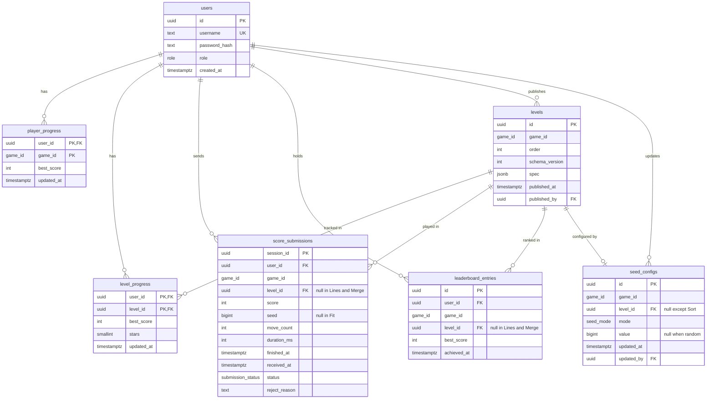

# Data Model

PostgreSQL schema of the HexaBlock Suite backend (hosted on Supabase).

- Related: [`api-contracts.md`](./api-contracts.md) (what the API exposes),
  and the
  [domain model](https://github.com/PepeTza/hexablock-client/blob/main/docs/domain-model.md)
  and
  [business rules](https://github.com/PepeTza/hexablock-client/blob/main/docs/business-rules.md)
  in the client repo.
- Status: **draft**.

## 1. Principles

- **The database stores data; it does not hold business rules.** Rules such as
  "a fixed seed must have a value", "stars are 1 to 3" or "published levels
  are immutable" live in the domain (aggregates and use cases), not in
  triggers or check constraints. The database only enforces **integrity**:
  primary keys, foreign keys, required columns and uniqueness.
- **Progress and leaderboard are separate.** Progress is reported by the
  device and only merged (RN-36). The leaderboard only contains scores the
  server has **validated** (RN-39). Keeping them apart means inflated progress
  can never reach the leaderboard.
- **One repository per aggregate.** Each table group below belongs to one
  aggregate of the domain model; repositories load and save whole aggregates.
- **ORM: Prisma.** The schema is described in `prisma/schema.prisma` and
  changed only through migrations. Prisma lives in the outermost layer, behind
  the repository ports (`IUserRepository`, `IProgressRepository`, ...); the
  domain never imports it.

## 2. Diagram



## 3. Enumerations

| Enum | Values |
|---|---|
| `game_id` | `hexa-lines`, `hexa-fit`, `hexa-sort`, `hexa-merge` |
| `role` | `player`, `admin` |
| `seed_mode` | `fixed`, `random` |
| `submission_status` | `accepted`, `rejected` |

Prisma enum values cannot contain hyphens; use `hexa_lines` etc. in the
schema with `@map("hexa-lines")`, so the stored and API value stays
`hexa-lines`.

## 4. Tables

### `users` — aggregate `User`

| Column | Type | Notes |
|---|---|---|
| `id` | `uuid` PK | Generated by the server |
| `username` | `text`, unique | Stored already normalised to lower case by the `Username` value object, so uniqueness is case-insensitive |
| `password_hash` | `text` | bcrypt or argon2 hash; never the plain password (RNF-10) |
| `role` | `role` | `player` by default |
| `created_at` | `timestamptz` | |

### `player_progress` and `level_progress` — aggregate `PlayerProgress`

One `player_progress` row per user and variant (RN-33). For level-based
variants, one `level_progress` row per completed level.

`player_progress`

| Column | Type | Notes |
|---|---|---|
| `user_id` | `uuid` FK → `users` | PK part |
| `game_id` | `game_id` | PK part |
| `best_score` | `int` | Used by Lines and Merge; `0` for Fit and Sort |
| `updated_at` | `timestamptz` | |

`level_progress`

| Column | Type | Notes |
|---|---|---|
| `user_id` | `uuid` FK → `users` | PK part |
| `level_id` | `uuid` FK → `levels` | PK part |
| `best_score` | `int` | |
| `stars` | `smallint` | Fit only; `null` in Sort |
| `updated_at` | `timestamptz` | |

The merge rule (best score, max stars, union of levels) is applied by the
`PlayerProgress` aggregate before saving, not by SQL.

### `levels` — aggregate `LevelDefinition`

| Column | Type | Notes |
|---|---|---|
| `id` | `uuid` PK | `levelId` in the API |
| `game_id` | `game_id` | Only `hexa-fit` or `hexa-sort` (checked in the domain) |
| `order` | `int` | Unique together with `game_id`; assigned as last + 1 |
| `schema_version` | `int` | Version of the `spec` format |
| `spec` | `jsonb` | Variant-specific content (see `api-contracts.md` §6, **TBD**) |
| `published_at` | `timestamptz` | |
| `published_by` | `uuid` FK → `users` | The admin who published it |

Published levels are never updated or deleted (RN-37). This is enforced by the
repository, which exposes no update or delete operation, and by the use case.

### `seed_configs` — aggregate `SeedConfig`

| Column | Type | Notes |
|---|---|---|
| `id` | `uuid` PK | |
| `game_id` | `game_id` | |
| `level_id` | `uuid` FK → `levels`, nullable | Set only for Hexa Sort |
| `mode` | `seed_mode` | |
| `value` | `bigint`, nullable | Unsigned 32-bit seed; `null` when `random` |
| `updated_at` | `timestamptz` | |
| `updated_by` | `uuid` FK → `users` | Audit of who changed it (CU-18) |

One row per variant (Lines, Merge) or per Sort level.

### `score_submissions` — log of every submission

Every `POST /scores` is stored, accepted or not, so rejected scores are logged
on the server (RN-43) and duplicates are detected.

| Column | Type | Notes |
|---|---|---|
| `session_id` | `uuid` PK | Sent by the client; a repeated id is the same submission (CU-13 A4) |
| `user_id` | `uuid` FK → `users` | |
| `game_id` | `game_id` | |
| `level_id` | `uuid` FK → `levels`, nullable | |
| `score` | `int` | |
| `seed` | `bigint`, nullable | |
| `move_count` | `int` | |
| `duration_ms` | `int` | |
| `finished_at` | `timestamptz` | Reported by the client |
| `received_at` | `timestamptz` | Set by the server |
| `status` | `submission_status` | |
| `reject_reason` | `text`, nullable | Why the plausibility check failed |

### `leaderboard_entries` — aggregate `LeaderboardEntry`

One row per player and table: per variant in Lines and Merge, per level in
Fit and Sort (RN-43). Only updated when an accepted submission beats the
current best.

| Column | Type | Notes |
|---|---|---|
| `id` | `uuid` PK | |
| `user_id` | `uuid` FK → `users` | |
| `game_id` | `game_id` | |
| `level_id` | `uuid` FK → `levels`, nullable | |
| `best_score` | `int` | |
| `achieved_at` | `timestamptz` | `finished_at` of the best submission; earliest wins ties |

The **global** Fit and Sort leaderboard (sum of level scores, RN-34) is not
stored: it is computed by a query (or a database view) over
`leaderboard_entries`, so it can never be out of date.

## 5. Uniqueness with nullable `level_id`

In PostgreSQL, `NULL` values are distinct in a normal unique index, so
`unique (user_id, game_id, level_id)` would allow two Lines entries for the
same player. Use two partial unique indexes instead, added in the migration
SQL:

```sql
CREATE UNIQUE INDEX leaderboard_per_game
  ON leaderboard_entries (user_id, game_id) WHERE level_id IS NULL;
CREATE UNIQUE INDEX leaderboard_per_level
  ON leaderboard_entries (user_id, level_id) WHERE level_id IS NOT NULL;

CREATE UNIQUE INDEX seed_config_per_game
  ON seed_configs (game_id) WHERE level_id IS NULL;
CREATE UNIQUE INDEX seed_config_per_level
  ON seed_configs (level_id) WHERE level_id IS NOT NULL;
```

These are integrity constraints (no duplicated rows), not business rules.

## 6. Indexes for frequent queries

| Query | Index |
|---|---|
| Leaderboard top 50 (CU-14) | `leaderboard_entries (game_id, level_id, best_score DESC, achieved_at ASC)` |
| New levels after an order (CU-15) | Covered by the unique `levels (game_id, order)` |
| Rate limit per user (RN-39) | `score_submissions (user_id, received_at)` |

## 7. Environments and migrations

- **Production:** Supabase PostgreSQL. The connection string comes from the
  `DATABASE_URL` environment variable; never committed (RNF-10).
- **Local development and tests:** a disposable PostgreSQL (e.g. Docker); tests
  never touch Supabase.
- **Migrations:** created with Prisma (`prisma migrate dev`) and committed;
  applied in deployment with `prisma migrate deploy`. Never edit an applied
  migration; add a new one.
- **Seed data:** the initial Fit and Sort levels and default seed configs are
  loaded by a seed script, through the same domain validation as the panel.

## 8. Changing the database

The design keeps the database replaceable, at three levels:

| Change | Effort | What changes |
|---|---|---|
| Another PostgreSQL host (Supabase → Neon, Railway, local) | Trivial | Only `DATABASE_URL` |
| Another SQL engine (e.g. MySQL) | Moderate | Prisma `provider`, PostgreSQL-specific parts (`jsonb`, partial indexes in §5, enums), regenerated migrations and a data migration |
| Another ORM or no ORM | Contained | Only the `Prisma...Repository` adapters; domain and use cases depend on the repository ports and do not change |
